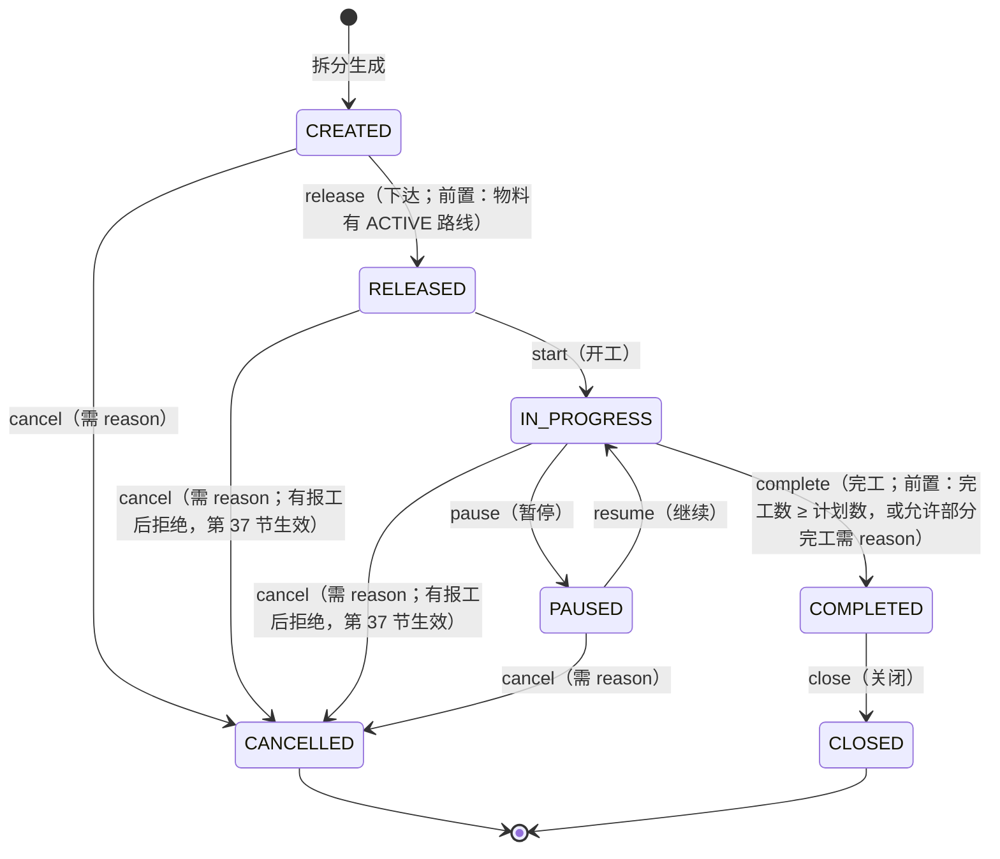

# 工单状态机（第 30 节）

> 本文件是规格：图和表先于人写，Service 里的转换表常量必须与下表一致（第 32 节有测试对照）。

## 状态图

## 转换表（当前状态 × 动作 → 目标状态）

| 状态 \ 动作 | release | start | pause | resume | complete | close | cancel |
|---|---|---|---|---|---|---|---|
| CREATED | RELEASED | ✗ | ✗ | ✗ | ✗ | ✗ | CANCELLED |
| RELEASED | ✗ | IN_PROGRESS | ✗ | ✗ | ✗ | ✗ | CANCELLED |
| IN_PROGRESS | ✗ | ✗ | PAUSED | ✗ | COMPLETED | ✗ | CANCELLED |
| PAUSED | ✗ | ✗ | ✗ | IN_PROGRESS | ✗ | ✗ | CANCELLED |
| COMPLETED | ✗ | ✗ | ✗ | ✗ | ✗ | CLOSED | ✗ |
| CLOSED | ✗ | ✗ | ✗ | ✗ | ✗ | ✗ | ✗ |
| CANCELLED | ✗ | ✗ | ✗ | ✗ | ✗ | ✗ | ✗ |

## 设计决策（第 30 节选定，理由写入日志）

- **complete 前置条件**：本阶段允许部分完工并要求必填 reason（选"允许并要求 reason"）——小厂常有尾数/报废，硬卡完工数会逼用户造假数据；报工模块（第 37 节）接入后再收紧为"完工数 ≥ 计划数或填写原因"。
- **cancel 需要理由**：所有 cancel 请求 reason 必填（400）。
- **转换表实现**：常量对象 `{ 状态: { 动作: 目标状态 } }`，Service 只查表；`transition(workOrderId, action, ctx)` 唯一入口，非法转换抛 1006（消息含当前状态与允许动作）。
- **接口**：全部 `POST /work-orders/:id/<action>`，body 里只放 reason（可选字段）。
- **乐观锁**：`WorkOrder.version`，第 31 节接入 transition。
